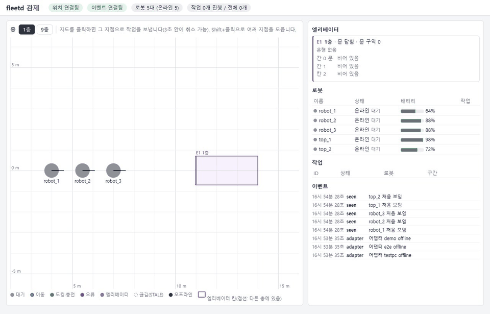
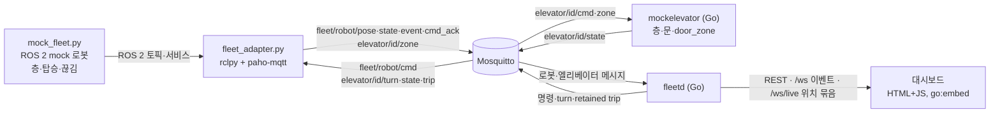
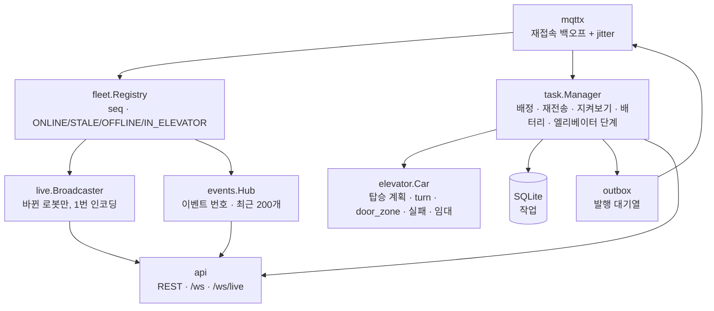
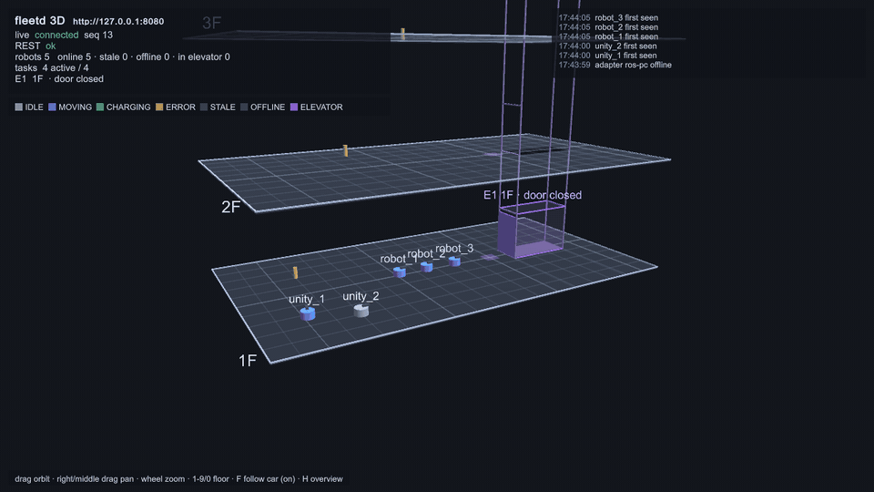

# fleet-lab

목적층이 다른 로봇 여러 대를 엘리베이터 한 대에 함께 태우는 로봇 관제 서버(Go)와, 그것을 실제 프로세스로 돌려 보는 실험실.
ROS 2 mock 로봇 → 어댑터(Python) → MQTT(Mosquitto) → 관제 서버 `fleetd`(Go) → 대시보드(브라우저)까지 모두 들어 있고, 엘리베이터도 MQTT로 붙는 mock이다.



1층의 robot_1·2·3에게 2·4·3층 작업을 동시에 보낸 장면(실제 약 50초를 약 2.3배속). 서버가 탑승 순서를 4층→3층→2층 로봇으로 정해 가장 먼저 내릴 robot_1이 마지막에 문 쪽 칸(칸 0)에 타고, 2·3·4층에서 한 대씩 차례로 내린다. 화면은 엘리베이터가 있는 층을 따라간다. 재현: `scripts\demo.bat` 후 `scripts\demo_tasks.ps1 up`.

**이기종 로봇:** ROS 2 로봇(어댑터 경유)과 ROS 없이 MQTT로 직접 붙는 Unity 로봇을 fleetd 하나가 함께 관제한다. Unity 로봇도 ROS 로봇과 같은 엘리베이터 규약으로 타서, 두 종류가 한 차에 함께 탄다([docs/ROBOT_PROTOCOL.md 9.1](docs/ROBOT_PROTOCOL.md#91-엘리베이터-탑승)). 엘리베이터를 못 타는 로봇(Unity `-canRide false`)은 상태에 `can_ride: false`를 보내고, 다른 층 작업을 받지 않는다. 규약은 [docs/ROBOT_PROTOCOL.md](docs/ROBOT_PROTOCOL.md), 3D 대시보드는 [아래](#3d-대시보드-unity).

## 왜 만들었나

현업에서 로봇 여러 대를 엘리베이터에 태울 때, **목적층이 같은 로봇끼리만** 함께 태울 수 있었다.

- 엘리베이터 안에서는 로봇 와이파이가 끊겨 엘리베이터 통신만 살아 있었고, 나머지는 오프라인으로 처리해야 했다.
- 목적층이 다르면 누가 먼저 내릴지, 안쪽 로봇이 내릴 때 문 쪽 로봇을 어떻게 비킬지 정리하기 어려웠다.
- 좁은 칸에서 두 로봇이 동시에 움직이면 멀티로봇 회피가 제대로 동작하지 않았다.

그래서 목적층이 다른 로봇을 함께 태우는 기능은 내지 못했다. 이 프로젝트는 그 문제를 이렇게 푼다.

1. **탑승 전에 서버가 계획한다.** 하차는 가까운 층부터, 탑승은 그 반대(가장 멀리 가는 로봇이 먼저 타서 안쪽). 그러면 어느 층에서든 내릴 로봇이 문 쪽에 있다.
2. **계획은 와이파이가 있는 로비에서 미리 내려보낸다.** 모두 수락해야 탑승을 시작한다. 차 안에서는 서버와 말할 수 없다는 전제다.
3. **문은 한 번에 한 대.** 서버가 엘리베이터 채널로 한 로봇에게만 차례(turn)를 주고, 엘리베이터가 문 구역이 비었다고 알려야 다음 로봇에게 준다.

1~5단계(연결, 끊김, 작업 배정, 배터리, 대시보드)는 이 이야기를 위한 기반이고, 6단계가 핵심, 7단계는 CI·부하 테스트·정리다. 계획은 [PLAN.md](PLAN.md).

## 구조



fleetd 안:



글자로 보면:

```
[mock_fleet.py] --ROS 2--> [fleet_adapter.py] --MQTT--> [Mosquitto] <--MQTT--> [fleetd] --HTTP/WebSocket--> [브라우저]
                                                             ^
                                          [mockelevator] ----+  (엘리베이터 채널: 차 안 로봇도 이것만은 쓴다)
```

## 빠른 시작

필요한 것: Go 1.27+, Mosquitto(127.0.0.1:1883), ROS 2 Jazzy(pixi, `C:\pixi_ws`) + `paho-mqtt`. Windows 기준.

```bat
scripts\demo.bat
```

mock 엘리베이터, fleetd, 1층 mock 로봇 3대(로밍 끊김 포함), 9층 2대, 어댑터가 각각 창으로 뜬다. 브라우저에서 http://127.0.0.1:8080/ 을 연다.
지도를 클릭하면 그 자리로 작업이 간다. 로봇 5대가 모두 ONLINE이 되면 함께 타기를 본다:

```bat
powershell -ExecutionPolicy Bypass -File scripts\demo_tasks.ps1 up
rem 1층 3대 → 2·4·3층: 운행 1번, 탑승 4·3·2, 정차 2·3·4
powershell -ExecutionPolicy Bypass -File scripts\demo_tasks.ps1 down
rem 9층 2대 → 8·7층
```

오른쪽 위 엘리베이터 칸에서 층·문·문 구역 수·칸별 로봇·단계가 보이고, 차가 있는 층을 고르면 차 안 로봇이 보라색으로 그려진다. 하나씩 띄우는 방법은 아래 [실행](#실행).

## 화면

> 스크린샷과 GIF는 아직 없다. 넣을 장면: ① 1층 로봇 3대가 7·5·3 순서로 타는 모습(문 구역 1대) ② 엘리베이터 칸의 칸별 로봇과 내릴 층
> ③ 로밍 끊김(STALE 점선 → 복구) ④ 하차 실패 → "넘겨짐" → 다음 층. 찍으면 `docs/images/`에 두고 여기에 링크한다.

## 단계별 기능

| 단계 | 한 일 | 자세히 |
|---|---|---|
| 1 연결 | 어댑터가 ROS 2 ↔ MQTT 변환(위치 5 Hz·데드밴드, 상태 1초, LWT, 재접속 백오프 + jitter). 서버는 seq로 옛 메시지·중복을 버린다 | [MQTT 토픽](PLAN.md#3-메시지-설계), [API](#api) |
| 2 끊김 | 서버가 받은 시각으로 ONLINE / STALE(2초) / OFFLINE(20초·LWT), 복구는 연속 3번. 이벤트 번호로 순서 보장, `/ws` 스트림 | [연결 상태](#연결-상태) |
| 3 작업 | 지점 목록 작업, 가장 가까운 로봇 배정, `cmd_id` + 유효 기간 + 3초 재전송, 응답 유실 복구, 두 로봇이 같은 작업을 하지 않게 지켜보기, SQLite 저장과 재시작 복구 | [작업](#작업) |
| 4 배터리 | 25% 미만 제외·90%에서 해제(히스테리시스), 일을 마친 뒤 도크, 10% 미만이면 작업을 돌려줌 | [배터리](#배터리) |
| 5 대시보드 | 바뀐 로봇만 담은 위치 묶음을 0.15초마다 **한 번만** 인코딩해 모든 브라우저에, 느린 브라우저는 옛 묶음을 버리고 스냅샷으로 다시 맞춤. 브라우저는 보간 | [대시보드](#대시보드) |
| 6 엘리베이터 ⭐ | 탑승 계획(순수 함수), 로비에서 미리 수락, 한 대씩 turn + `door_zone`, 하차 실패 → 재시도 → 다음 층, 갇힘 → 사람 호출·운영자 반환, retained 운행으로 재시작 이어받기. mock 엘리베이터·mock 로봇·어댑터까지 실제 프로세스로 | [엘리베이터](#엘리베이터-6단계), [docs/ELEVATOR.md](docs/ELEVATOR.md) |
| 7 마무리 | GitHub Actions(`go test -race` 포함), 실제 fleetd를 상대로 한 부하 테스트(`cmd/loadtest`), 이 README | [docs/LOAD_TEST.md](docs/LOAD_TEST.md), [CI](.github/workflows/ci.yml) |

## 설계 결정

| 결정 | 이유 |
|---|---|
| **로봇 안 어댑터 + MQTT**, 서버는 ROS 2(DDS)에 직접 붙지 않음 | DDS 탐색·멀티캐스트는 현장 네트워크와 클라우드 사이를 잘 넘지 못한다. 로봇마다 어댑터가 MQTT로 말하는 구조가 일반적이다(Open-RMF fleet adapter와 같은 패턴). LWT·retained로 끊김을 표현하기 좋고, Go용 ROS 2 라이브러리 없이 Windows에서 빌드된다. 로봇을 Nav2로 바꿔도 어댑터만 바뀐다 |
| **엘리베이터도 MQTT, 로봇과 다른 채널** | 현장 조건 재현: 차 안에서 로봇 와이파이(`fleet/*`)는 끊기지만 엘리베이터 채널은 산다. 어댑터는 탑승부터 하차 1초 뒤까지 `fleet/*` 발행을 실제로 멈춘다(e2e가 메시지 0개를 확인) |
| **문 차례(turn)는 서버가 준다** | 로봇끼리 순서를 정하게 하면 차 안에서 서로를 볼 방법이 없다. 서버(지휘자)가 한 로봇에게만 turn을 주고 답(`clear`/`failed`)을 받는다. 열린 turn은 5초마다 같은 번호로 다시 보내 유실을 메우고, 로봇은 같은 번호에 같은 답을 한다 |
| **다음 turn은 `door_zone: 0`을 본 뒤에만** | 시간 초과로 다음 로봇을 움직이면 앞 로봇이 아직 문에 있을 때 두 대가 겹친다(6a 리뷰에서 실제로 찾음). 엘리베이터 센서(mock은 `enter`/`clear`로 셈)가 문 구역이 비었다고 알려야 다음으로 간다. 시간 초과는 같은 로봇의 실패한 시도로만 센다 |
| **운행 상태는 retained `elevator/{id}/trip`** | fleetd가 탑승 중에 재시작해도 브로커에 남은 운행을 이어받는다(탑승 전이었으면 안전하게 중단). 끝나면 지우고, 끝난 운행 ID를 기억해 자기 메아리를 무시한다 |
| **배터리 히스테리시스 25% / 90%** | 하나의 기준이면 25% 근처에서 배정·제외가 반복된다. 90%까지 충전해야 다시 배정한다. 충전기가 90% 전에 멈추면 한 번만 다시 보내 끝없는 도크 왕복을 막는다 |
| **위치 묶음은 한 번만 인코딩, 느린 브라우저는 버림** | 서버 → 브라우저 전송량은 로봇 수 × 브라우저 수 × 빈도로 커진다. 묶음을 브라우저마다 만들면 인코딩도 브라우저 수만큼 늘고, 느린 브라우저를 기다리면 모든 브라우저가 그 속도로 떨어진다. 부하 테스트(로봇 500대): 브라우저 60개에서 브라우저마다 인코딩하면 fleetd CPU 13% → 26%, 지연 중앙값 1.0 → 7.7 ms. 느린 브라우저 2개를 기다리면 빠른 브라우저도 초당 6.7 → 2.0개, p99 지연 1.6 ms → 1초. 대신 버림 방식에서도 느린 브라우저가 보는 상태는 몇 초(중앙값 3.3초) 묵는다(알려진 한계) |
| **명령은 `cmd_id` + `expires_at`, 응답 없으면 같은 ID로 재전송** | QoS 1 중복과 응답 유실을 함께 다룬다. 어댑터는 같은 ID를 다시 실행하지 않고 마지막 응답을 다시 보내므로, `done`이 유실돼도 재전송으로 되찾는다. 재연결 뒤 옛 명령은 유효 기간으로 막는다 |
| **끊김 판단은 서버가 받은 시각, 순서는 seq** | 로봇과 서버의 시계 차이와 상관없다. 같은 로봇의 옛 메시지·중복은 seq로 버리고, 어댑터 재시작은 `boot`로 구분한다 |

## 테스트

| 종류 | 개수 | 어디 | 무엇을 |
|---|---|---|---|
| Go 전체 | 테스트 함수 208개 (아래 sim 포함, 하위 테스트까지 272개; `go test -list . ./...`, `go test -v ./...`의 `--- PASS` 줄), 몇 초 | `internal/*`, `cmd/*` | seq·연결 상태·배정·재전송·배터리·묶음·계획·지휘·API·mock 엘리베이터. 로직은 가짜 시계, HTTP/WebSocket은 `httptest` |
| 통합 sim (Go) | 19개 | `internal/sim` | ROS·MQTT 없이 실제 `Registry`·`Manager`에 가짜 로봇·엘리베이터를 붙임. 지연·순서 뒤바뀜·응답 유실·실패 주입, 50 ms마다 "문 구역 1대·한 작업 한 로봇" 검사 |
| 성질 (property) | 무작위 5,000개 | `internal/elevator` `TestPlanProperties` | 매 정차층에서 내릴 로봇이 모두 문 쪽, 칸 수, 방향, 결정성, 입력 순서 무관 |
| 변이 실험 | 단계마다 수동 (6단계만 70여 개) | [TEST_PLAN](docs/TEST_PLAN.md) | 조건 하나를 일부러 깨서 적어도 한 테스트가 실패하는지 확인. 살아남은 변이는 테스트를 보강 |
| 어댑터 (pytest) | 74개 | `adapter/` | ROS 없이: 순수 로직(`fleet_logic.py`), 가짜 rclpy·paho로 배선(`test_adapter_wiring.py`) |
| 대시보드 JS (node) | 31개 | `scripts/web_test.js` | 보간·외삽, 격자 상한, 이벤트 빈틈 채우기, 엘리베이터 칸·경보 계산 |
| 끝단 e2e | 시나리오 71개 (약 5분 반) | `scripts/e2e.bat` | Mosquitto + fleetd + mock 엘리베이터 + ROS 2 mock 로봇 + 어댑터를 실제로 띄움. 함께 타기 3·7·5층, 하차 실패, turn 유실, 갇힘 → 반환 → 꺼냄, 서버 재시작, 배터리, `/ws/live` |
| 부하 | 설정 9가지 × 3번 (약 9분) | `cmd/loadtest` | 실제 fleetd에 가짜 로봇 500대(MQTT)와 브라우저 20개(WebSocket). [docs/LOAD_TEST.md](docs/LOAD_TEST.md) |

CI(GitHub Actions, [ci.yml](.github/workflows/ci.yml)): gofmt·`go vet`·`go test -race`·Windows 빌드, node, pytest(ROS 없이),
Mosquitto를 깔고 작은 부하 테스트(로봇 300대, `-check`)로 fleetd가 실제로 뜨고 붙는지, 브라우저 오류가 없는지, 느린 브라우저 때문에 묶음을 실제로 버리고 스냅샷으로 다시 맞추는지 확인. e2e는 ROS 2가 필요해 로컬에서만 돌린다.
이 PC에는 C 컴파일러가 없어 `-race`는 CI에서만 돈다.

## 부하 테스트 요약

[docs/LOAD_TEST.md](docs/LOAD_TEST.md)에 방법·표·해석이 있다. 한 PC(Ryzen 5 7500F, Windows 11)에서 실제 fleetd + Mosquitto에 로봇 500대(모두 이동, 위치 초당 2,500개)를 붙이고, 시나리오마다 새 fleetd로 3번씩 재서 중앙값을 적었다.

| 비교 | 결과 |
|---|---|
| 기본 상태 (브라우저 20개, 그중 2개 느림) | fleetd CPU 한 코어의 약 9%, 묶음 80 KB × 초당 6.7개, 빠른 브라우저 지연 p50 1.0 ms · p99 1.6 ms |
| 묶음 한 번 인코딩 vs 브라우저마다 (번갈아 3번씩) | 20개: 지연 p50 1.0 → 3.1 ms, p99 1.6 → 5.7 ms, CPU 9 → 14%. 60개: CPU 13 → 26%, p50 1.0 → 7.7 ms, p99 4.7 → 17.6 ms |
| 느린 브라우저 버림 vs 기다림 | 기다리면 빠른 브라우저 18개도 초당 6.7 → 2.0개, p99 1.6 ms → 1,001 ms. 버리면 느린 쪽만 스냅샷으로 다시 맞추고(초당 9.6개 버림) 나머지는 그대로. 단 느린 브라우저가 보는 상태는 버림에서 중앙값 3.3초·최대 4.0초, 기다림에서 7.0·7.9초 묵음 |
| 500대 동시 재접속 jitter vs 없음 | 100 ms당 최대 시도 약 60 vs 500. 없으면 끊김이 끝난 뒤의 시도 중 실행마다 14~188개(중앙값 2.5초 끊김 105, 3.5초 끊김 149)가 거절됨. 거절한 것은 Mosquitto가 아니라 부하 테스트 자신의 Go 프록시 listen 소켓(Windows 접속 대기열)이다. 모두 다시 붙기까지: 2.5초 끊김 8.3 vs 7.05초, 3.5초 끊김 9.4 vs 15.1초 |

jitter의 의미는 평균 복구 시간보다 **몰림을 없애는 데** 있었다. 잰 두 끊김(2.5초, 3.5초)에서 jitter 쪽은 끊김이 끝난 뒤 5.7~6.0초에 모두 붙었고, jitter 없는 쪽은 4.6초와 11.6초로 끊김 길이에 따라 크게 달랐다(2.5초 끊김에서는 오히려 빨랐다). 백오프가 두 배씩 늘어나므로 더 긴 끊김에서도 jitter 쪽이 6초 근처라고 말할 수는 없다(재지 않음).

## 실제 운영이라면

- **보안:** MQTT는 TLS(8883)와 로봇별 인증서·계정, 브로커 ACL로 로봇은 `fleet/<자기 이름>/#`와 자기가 탈 엘리베이터 채널만 쓰게 한다(Mosquitto `pattern write fleet/%u/#`).
  지금은 localhost에 인증 없음이다. HTTP는 운영자 인증과 HTTPS, 작업 생성·운영자 반환 같은 POST에 권한·감사 기록.
- **배정 거리:** 지금은 직선 거리 + 층당 1000 m 가산이다. 실제로는 지도 위 경로 거리(Nav2 `ComputePathToPose`나 미리 만든 길 그래프)와 엘리베이터 대기 시간을 넣어 고른다.
- **엘리베이터 여러 대:** 설정에 여러 대를 둘 수 있지만, 구간마다 두 층을 모두 서는 첫 번째 차(ID 순)를 쓴다. 제대로 하려면 호출을 어느 차에 줄지(대기 로봇 수, 차 위치, 사람 승객) 정하는 배정이 필요하고, 벤더별 엘리베이터 API 어댑터가 들어간다.
- **텔레메트리:** SQLite에는 작업·이벤트만 둔다. 위치·배터리 이력이 쌓이면 TimescaleDB·InfluxDB 같은 시계열 DB로 따로 보내고 보존 기간을 둔다.
- **이중화(HA):** fleetd는 지금 한 프로세스이고 상태가 메모리 + SQLite에 있다. 운영이면 상태를 Postgres 같은 공유 저장소로, 리더 선출로 한 대만 지휘(엘리베이터 지휘자가 둘이면 안 된다),
  브로커는 클러스터·브리지. 재시작 이어받기(retained 운행, 25초 유예)는 이미 있으므로 그 위에 얹는다.
- **관측:** `/live/stats` 같은 수치를 Prometheus로, 엘리베이터 갇힘·임대 초과 경보를 호출 시스템으로.

## 알려진 한계

- 엘리베이터: 여러 대 사이 최적 배정 없음(두 층을 서는 첫 차), 사람 승객 고려 없음. 로비 대기 자리가 점 하나. 한 칸 줄(single file) 모델이라 앞 로봇이 못 내리면 같은 층의 뒤 로봇도 넘긴다.
  차 안에서는 와이파이가 항상 끊긴다고 가정한다("와이파이로 ONLINE이면 차 밖"). ([ELEVATOR.md 12장](docs/ELEVATOR.md))
- 브로커가 retained 메시지를 잃으면(영속 저장 꺼짐 + 재시작) 탑승 중 운행을 이어받지 못하고 사람이 필요하다.
- 어댑터를 탑승 중에 재시작하면 ride를 잃는다(로봇은 ERROR로 보고해 배정은 막지만, 꺼내는 것은 사람). 서버 재시작 중 탑승은 Go 테스트로만 확인했고 e2e는 없다.
- 엘리베이터 응답 없음·문 막힘은 주입 옵션과 Go 테스트만 있고 e2e 단계는 없다. mock 로봇의 "움직이다 고장"은 자동 테스트가 없다.
- 배터리 충전 필요 표시는 메모리에만 있어, 재시작 전에 충전이 끊겨 25~90%로 IDLE인 로봇은 표시를 잃고 바로 배정될 수 있다.
- 화면 그리기와 클릭은 자동 테스트가 없다(수동 확인). 서버가 연결을 잡은 채 멈춘 경우의 "응답 없음" 표시는 Go 테스트로만 확인했다.
- **느린 브라우저가 보는 상태의 나이는 묶여 있지 않다.** 버림은 빠른 브라우저를 지키고 빈틈 없이 다시 맞추지만, 0.5초마다 하나씩 읽는 브라우저는 대기열(8칸)과 소켓 버퍼에 쌓인 묶음을 차례로 읽어 3~4초 묵은 상태를 본다.
  묶으려면 브라우저마다 "최신 하나만" 두거나 대기열을 1~2칸으로 줄이고, 소켓에 쌓이는 몫은 쓰기 버퍼를 줄이거나 흐름 제어로 막아야 한다([LOAD_TEST.md](docs/LOAD_TEST.md)).
- 부하 테스트는 한 PC에서 fleetd·Mosquitto·부하 생성기를 함께 돌린 값이다. 로봇 500대가 모두 계속 움직이는 최악 조건이고, 다른 PC·네트워크에서는 숫자가 다르다.
- `go test -race`와 CI 전체는 push한 뒤에야 처음 돈다(이 PC에는 C 컴파일러가 없음). 경합은 코드를 읽어 찾아 고쳤지만 실행으로 확인하지 못했다.

---

# 상세

아래는 동작 규칙을 자세히 적은 참고 문서다.

## 폴더

| 폴더 | 내용 |
|---|---|
| `cmd/fleetd` | 관제 서버 진입점 |
| `cmd/loadtest` | 부하 테스트(7단계): 실제 fleetd를 띄워 MQTT 로봇 N대와 WebSocket 브라우저 M개로 CPU·지연·버림·재접속 폭풍을 잼. [docs/LOAD_TEST.md](docs/LOAD_TEST.md) |
| `cmd/mockelevator` | MQTT mock 엘리베이터(6b): fleetd와 같은 `-elevators` 설정으로 층 이동·문·유지·`door_zone`·실패 주입 |
| `internal/fleet` | 로봇 목록, seq 검사, 연결 상태(ONLINE/STALE/OFFLINE/IN_ELEVATOR), MQTT 메시지 수신 |
| `internal/events` | 이벤트 배포 (느린 수신자는 건너뜀), 최근 이벤트 보관 |
| `internal/mqttx` | MQTT 연결 (재접속 백오프 + jitter, 재구독) |
| `internal/task` | 작업 배정·명령 재전송·재배정·취소, 배터리 정책(`battery.go`), 다른 층 구간의 엘리베이터 단계(`ride.go`) (가짜 시계로 테스트) |
| `internal/elevator` | 엘리베이터 함께 타기: 탑승 계획(`plan.go`, 순수 함수), 운행 지휘(`car.go`: 모으기·호출·한 대씩 문·실패·임대), MQTT 메시지(`proto.go`), 설정(`config.go`). 규약은 [docs/ELEVATOR.md](docs/ELEVATOR.md) |
| `internal/store` | 작업을 SQLite에 저장 (modernc.org/sqlite, cgo 없음) |
| `internal/sim` | 통합 테스트용 가짜 로봇과 엘리베이터 (MQTT·ROS 없이 실제 Registry와 Manager에 연결, 배터리·도킹, 층·탑승·차 안 끊김·실패 주입 포함) |
| `internal/api` | REST API, WebSocket(`/ws` 이벤트, `/ws/live` 위치 묶음), 대시보드 파일 제공 |
| `internal/live` | 대시보드용 위치 묶음: 바뀐 로봇만 0.15초마다 한 번 만들어 모든 브라우저에 같은 바이트로, 느린 브라우저는 오래된 묶음을 버리고 전체 스냅샷으로 다시 맞춤 |
| `web/` | 대시보드 (HTML·CSS·JS 하나씩, 빌드 없음, 외부 CDN 없음, `go:embed`로 fleetd에 들어감) |
| `mock_robots/` | ROS 2 mock 로봇 (Gazebo 없음) |
| `adapter/` | ROS 2 ↔ MQTT 어댑터 |
| `docs/` | 테스트 계획과 리뷰 기록(`TEST_PLAN.md`), 엘리베이터 프로토콜(`ELEVATOR.md`), 부하 테스트 결과(`LOAD_TEST.md`) |
| `scripts/` | 끝단 시나리오 테스트 (`e2e.bat`), 대시보드 JS 테스트 (`web_test.js`), 데모 실행 (`demo.bat`, 엘리베이터 작업 `demo_tasks.ps1`) |
| `.github/workflows/` | CI (`ci.yml`): Go(gofmt·vet(Linux·Windows)·`-race`), node, pytest, Mosquitto 위 작은 부하 테스트(`-check`) |

## 필요한 것

- Go 1.27+
- Mosquitto (localhost:1883)
- ROS 2 Jazzy + Python `paho-mqtt` (mock 로봇과 어댑터용)

## 실행

창 세 개를 쓴다. 로봇과 어댑터 창은 먼저 ROS 2 환경을 켠다.

```bat
cd C:\pixi_ws
pixi shell
call C:\pixi_ws\ros2-windows\local_setup.bat
```

1. 관제 서버: `go run ./cmd/fleetd` (`-mqtt-id`로 MQTT 클라이언트 ID(기본 `fleetd`, 같은 브로커에 fleetd를 둘 띄우면 서로 다르게), `-log debug`를 붙이면 버려진 오래된 메시지도 보인다. `-elevators <파일>`로 엘리베이터 설정, 없으면 기본 E1 하나, `-elevators none`이면 엘리베이터 없음)
2. mock 로봇: `python mock_robots\mock_fleet.py --count 3` (`--floor`/`--floors`로 시작 층)
3. 어댑터: `python adapter\fleet_adapter.py`
4. mock 엘리베이터(다른 층으로 가는 작업이 있을 때): `go run ./cmd/mockelevator` (fleetd에 `-elevators <파일>`을 줬으면 같은 파일을 준다)

브라우저에서 http://127.0.0.1:8080/ 을 열면 대시보드가 보인다. 한 번에 띄우려면 `scripts\demo.bat`(mock 엘리베이터·서버·1층 mock 로봇 3대(`--roam-rate 2`)·9층 mock 로봇 2대(`top_1`, `top_2`)·어댑터를 각각 창으로 띄움, Mosquitto 필요).
목적층이 다른 함께 타기를 보려면 로봇이 모두 ONLINE이 된 뒤 `powershell -ExecutionPolicy Bypass -File scripts\demo_tasks.ps1 up`(1층 3대 → 2·4·3층, 탑승 4·3·2),
그다음 `... demo_tasks.ps1 down`(9층 2대 → 8·7층). 엘리베이터 칸과 차 안 로봇은 차가 있는 층의 지도에서 보인다.

확인:

```bat
curl http://127.0.0.1:8080/robots
mosquitto_sub -t "fleet/#" -v
```

명령 보내기 (`cmd_id`는 매번 달라야 한다. 같은 ID는 중복으로 보고 무시한다):

```bat
mosquitto_pub -t fleet/robot_1/cmd -q 1 -m "{\"cmd_id\":\"c1\",\"type\":\"goto\",\"x\":3,\"y\":2}"
```

명령 종류: `goto`(x, y, yaw), `cancel`, `dock`, `reset_error`, `drop_comms`, `rescue`(차 안 로봇을 사람이 꺼냄, mock), `ride`(엘리베이터 탑승 계획, [docs/ELEVATOR.md](docs/ELEVATOR.md)). 결과는 `fleet/<robot>/cmd_ack`로 온다.
`goto`는 `accepted` 뒤에 `done` / `failed` / `cancelled`가 한 번 더 온다. 수행 중에는 로봇 상태의 `task_id`가 그 `cmd_id`다.
같은 `cmd_id`를 다시 보내면 실행하지 않고 마지막 응답을 다시 보낸다.

## 테스트 실행

```bat
go test ./...
cd C:\pixi_ws && pixi run python -m pytest C:\Users\han\Documents\fleet-lab\adapter
node scripts\web_test.js
scripts\e2e.bat
```

어댑터 pytest는 ROS 없이도 돈다(`test_adapter_wiring.py`가 rclpy·메시지 모듈을 가짜로 넣는다): 아무 Python 3.12에서 `python -m pip install pytest paho-mqtt` 뒤 `python -m pytest adapter`. CI도 이렇게 돌린다.

`web_test.js`는 `web/app.js`의 DOM 없는 부분(위치 보간·외삽, 격자 선 수 제한, 이벤트 빈틈 채우기, 엘리베이터 칸·차 안 로봇·경보 계산)을 Node로 시험한다(패키지 필요 없음). 화면 그리기와 클릭은 자동 테스트가 없다.

`e2e.bat`은 서버·mock 엘리베이터·mock 로봇·어댑터를 실제로 띄워 시나리오 71개를 돌린다(약 5분 반, Mosquitto 필요. 시작할 때 브로커에 남은 엘리베이터 retained 메시지를 지운다).
작업 배정, 서버 재시작 후 작업 이어가기, 배터리 정책(배터리가 낮은 로봇 `bat_1`을 따로 띄움), 대시보드와 `/ws/live`,
엘리베이터(1층 `lift_1..3` → 3·7·5층 함께 타기, 하차 실패 → 재시도 → 다음 층으로 넘김 → 다시 내려옴, turn 유실 + 문 지나기가 turn 시간 초과보다 느린 로봇,
마지막 층에서 갇힘 → 운영자 반환 → 꺼냄)도 여기서 확인한다. 모든 엘리베이터 시나리오에서 엘리베이터 상태를 구독해 문 구역 최대 1대, 모든 `enter`가 문이 열리고 비어 있는 서 있는 차 뒤에 옴,
문 구역에 로봇이 있는 채 이동한 적 없음, turn마다 `enter` 한 번, 차 안 로봇의 `fleet/*` 메시지 0개(하차 1초 뒤까지)를 확인한다.
`scripts\e2e.bat --only elevator`는 연결 확인과 엘리베이터 시나리오만 돌린다(약 4분).
엘리베이터의 Go 테스트: `internal/elevator`(계획 표·무작위 5,000개 성질 검사·지휘 단위 테스트), `internal/task/ride_test.go`, `internal/sim/elevator_test.go`(sim으로 실패 주입), `cmd/mockelevator`(mock 엘리베이터 동작).
어댑터의 탑승 절차는 `adapter/test_ride_logic.py`, 어댑터 배선(가짜 ROS·MQTT)은 `adapter/test_adapter_wiring.py`(pytest).
테스트 목록과 리뷰는 [docs/TEST_PLAN.md](docs/TEST_PLAN.md).

부하 테스트(Mosquitto 필요, 기본 시나리오 5개 × 3번에 약 5분): `go build -o bin\fleetd.exe .\cmd\fleetd` 뒤 `go run .\cmd\loadtest -fleetd bin\fleetd.exe`. 문서의 나머지 두 표(3.5초 끊김, 브라우저 60개)는 LOAD_TEST.md의 명령으로. 옵션과 결과는 [docs/LOAD_TEST.md](docs/LOAD_TEST.md).
fleetd의 `-bench-encode-per-client`, `-bench-block-slow`는 부하 테스트가 비교용으로만 켜는 숨은 스위치다(`-h`에 안 보임, 켜면 경고 로그). 운영에서는 쓰지 않는다.
CI는 위의 Go·node·pytest를 돌리고(`go test`는 `-race`로), e2e는 ROS 2가 필요해 돌리지 않는다.

## API

| 경로 | 내용 |
|---|---|
| `GET /robots`, `GET /robots/{name}` | 로봇 상태 (`conn` 포함) |
| `POST /elevators/{id}/release` | 운영자 강제 반환: 차 안 로봇을 사람이 처리한 뒤 묶인 엘리베이터를 푼다. 확인 안 된 로봇의 작업은 시도 없이 대기열로(지켜보기), 탑승 전 로봇은 다시 대기. 다른 POST와 같은 JSON·사이트 규칙. 없는 엘리베이터 `404`, 운행이 없으면 `409` |
| `GET /elevators` | 엘리베이터마다 설정(칸 수, 층, 로비), 마지막 상태(층·문·방향·유지·예약), 응답 여부, 지금 운행(단계, 로봇별 상태·칸·내릴 층, 현재 turn), 로비 대기열, 쉬는 시간. 형식은 [docs/ELEVATOR.md](docs/ELEVATOR.md) 10장 |
| `GET /events?n=50` | 최근 이벤트 (최대 200개) |
| `GET /events?since=<seq>` | `seq`보다 뒤의 보관 중인 이벤트. 첫 이벤트가 `seq+1`이 아니면 그 사이는 이미 버려졌다. 숫자가 아니면 `400` |
| `GET /ws` | WebSocket 실시간 이벤트 |
| `GET /ws/live` | WebSocket 위치 묶음 (아래 대시보드). 첫 메시지는 전체 스냅샷. 구독자는 64명까지, 넘으면 `503` |
| `GET /live/stats` | 묶음 통계: `frames`, `heartbeats`, `encodes`, `encode_errors`, `unencodable`(NaN·Inf라 건너뛴 로봇), `dropped`(느린 브라우저에서 버린 묶음), `resyncs`(버린 뒤 보낸 스냅샷), `refused`(구독자 한도로 거절), `subscribers`, `seq`. 벤치 모드(`-bench-block-slow`)에서만 `blocked`, `blocked_ms` |
| `GET /` | 대시보드 (`index.html`, `app.js`, `style.css`) |
| `POST /tasks` | 작업 추가. 본문 `{"waypoints":[{"x":1,"y":2,"floor":1}]}` (x, y, floor 모두 필수, |x|·|y| ≤ 1,000,000 m, 뒤에 다른 데이터 없음) → `201` + 작업. 형식이 틀리거나 범위 밖이면 `400`, 1 MB 넘으면 `413`, 저장 실패면 `500`(작업은 만들어지지 않음) |
| `GET /tasks?state=QUEUED` | 작업 목록 (만든 순서). `state`는 선택, 모르는 값이면 `400` |
| `GET /tasks/{id}` | 작업 하나. 없으면 `404` |
| `POST /tasks/{id}/cancel` | 취소. 로봇이 하던 중이면 `cancel` 명령을 보낸다. 이미 끝난 작업은 `409`, 없으면 `404` |

- **POST는 같은 사이트에서만:** 두 POST는 `Content-Type: application/json`이어야 하고(아니면 `415`; 취소는 본문 `{}`), 브라우저가 `Sec-Fetch-Site: cross-site`/`same-site`이거나 `Origin`이 이 서버가 아니라고 알리면 `403`이다.
  다른 웹 페이지가 운영자의 브라우저를 통해 작업을 만들거나 취소하지 못하게 하기 위해서다(JSON이면 CORS 사전 요청이 필요한데 이 서버는 답하지 않는다). curl·e2e처럼 브라우저가 아닌 클라이언트는 헤더 없이 그대로 쓴다. `/ws`·`/ws/live`는 `websocket.Accept`가 다른 출처를 거절한다.
- **모든 응답에 `X-Fleetd-Boot`:** 서버 실행마다 새로 정하는 ID. 이벤트 번호는 재시작하면 1부터 다시 시작하므로, 대시보드는 이 값이 바뀌면 이벤트를 처음부터 다시 받는다.
- **로봇이 보낸 값 검사:** 위치 |x|·|y| > 1,000,000 m, NaN·Inf, 속도 |v| > 100 m/s, 배터리가 0~100 밖, `silence_s`가 0~3600 밖이면 그 메시지를 통째로 버리고(로그 + `Registry.Rejected` 수) 로봇은 마지막 정상 값을 유지한다.
  아주 큰 값이 반올림에서 Inf가 되어 JSON 인코딩이 실패하고 fleetd가 죽던 문제(리뷰 5-1)를 막는다.

## 연결 상태

| 상태 | 조건 |
|---|---|
| `ONLINE` | 정상 수신 |
| `STALE` | 2초 이상 무응답 (와이파이 로밍 등). 하던 작업은 유지 |
| `OFFLINE` | 20초 이상 무응답, 또는 어댑터 LWT |
| `IN_ELEVATOR` | 로봇이 `silence_s`로 끊김을 예고함. 그 시간이 지나면 `elevator_overdue` 경보 |

복구는 연속 3번 정상 수신 후에 한다. 로밍 끊김은 `mock_fleet.py --roam-rate 6 --roam-max 4`로 흉내 낸다.

## 작업

작업은 지점 목록이다. 지점마다 한 구간(leg)씩 `goto`를 보내고, 마지막 지점에서 `done`이 오면 끝난다.

| 상태 | 뜻 |
|---|---|
| `QUEUED` | 로봇을 기다림 |
| `ASSIGNED` | 이번 구간의 `goto`를 보냄, 아직 `accepted` 전 |
| `RUNNING` | 로봇이 이번 구간을 받음 (`accepted` 또는 로봇 상태의 `task_id`가 그 `cmd_id`) |
| `DONE` / `FAILED` / `CANCELLED` | 끝. 목록에 계속 남는다 |

- **배정:** 먼저 들어온 작업부터. ONLINE·IDLE·에러 없음·위치를 받은 적 있음·충전 필요 아님(아래 배터리)·`task_id` 없음·
  다른 작업이 없는 로봇 중 다음 지점에 가장 가까운 로봇. 다른 층은 층마다 1000 m를 더한다. 거리가 같으면 이름순.
  그 작업에 실패한 적이 있는 로봇(`failed_on`)은 다른 로봇이 비어 있으면 건너뛴다.
  상태만 오고 위치(`pose`)가 아직 없는 로봇은 층·좌표가 0으로 보이므로 배정하지 않는다(`has_pose`). 구간 시간 제한도 위치가 온 뒤에 계산한다.
- **명령 ID:** `<작업>.<구간>.<배정 횟수>.<서버 실행 ID>` (예: `t-3.0.1.k3x9ab`). 서버 실행 ID는 시작할 때마다 새로 정하므로
  마지막 저장이 유실된 채 재시작해도 ID가 겹치지 않는다(겹치면 어댑터가 새 명령을 중복으로 보고 옛 응답을 돌려준다).
  `expires_at`은 보낼 때마다 지금 + 10초. 다른 층 구간의 엘리베이터 단계 명령은 뒤에 `.L<n>`(로비로 가는 goto), `.R<n>`(ride)이 붙는다.
- **응답이 없으면:** 3초마다 같은 `cmd_id`로 다시 보낸다(최대 3번). 어댑터는 같은 ID를 다시 실행하지 않고 마지막 응답을 다시 보내므로,
  `done` 응답이 유실돼도 이렇게 되찾는다. 로봇이 STALE·엘리베이터 안이면 기다리는 시간을 세지 않는다.
  끝까지 답이 없는 로봇은 1분 동안 새 작업을 받지 않는다.
- **구간 시간 제한:** 거리 / 0.3 m/s + 30초. 넘으면 로봇에 `cancel`을 보내고 다시 대기열로. STALE·엘리베이터 시간은 세지 않는다.
- **실패:** `failed`/`cancelled` 응답(어댑터 시계가 빨라 `expired`가 와도 같다), 응답 없음, 시간 초과, 로봇 OFFLINE·ERROR면
  시도 횟수를 늘리고 다시 대기열로. 3번 실패 뒤 한 번 더 실패하면 `FAILED`.
- **두 로봇이 같은 작업을 하지 않게:**
  - 로봇에게서 작업을 거둘 때 (로봇, `cmd_id`)를 지켜본다. 그 로봇이 그 `cmd_id`를 수행 중이라고 보고하면 `cancel`을 보내고(3초마다 반복),
    보고하지 않아도 마지막으로 보낸 명령이 아직 도착할 수 있는 동안(보낸 시각 + 10초 + 5초)은 계속 지켜본다.
    위치만 오고 상태가 아직 없는 로봇은 "모름"으로 본다.
  - 안전망: ONLINE 로봇이 자기 것이 아닌 작업의 `cmd_id`를 3초 넘게 보고하면 지켜보기에 넣어 취소한다.
    지켜보기 목록은 메모리에만 있으므로 재시작 뒤에는 이 규칙이 대신한다.
- **저장:** 바뀐 작업은 별도 고루틴이 SQLite(`-db`)에 쓴다(작업마다 최신 상태만, 실패하면 1초마다 다시 시도).
  관리자 잠금을 잡은 채 디스크에 쓰지 않으므로 MQTT 수신이 멈추지 않는다. 메모리 상태가 기준이고, 갑자기 꺼지면 아직 쓰지 못한
  변경만 잃는다(아래 재시작 규칙이 복구한다). 새 작업만은 저장한 뒤에 만든다. 읽을 수 없는 행은 기록하고 건너뛴다.
- **재시작:** `QUEUED`는 그대로. `ASSIGNED`/`RUNNING`은 MQTT에 처음 연결된 뒤 25초(OFFLINE 기준 20초보다 길게) 안에 로봇이
  그 `cmd_id`를 보고하면 이어 가고, 아니면 대기열로 돌아간다. 그 사이 로봇이 다른 것을 보고하면 같은 `cmd_id`를 한 번 다시 보내 본다
  (서버가 꺼진 동안 끝났다면 어댑터가 `done`을 다시 보낸다). STALE·엘리베이터 안 로봇은 OFFLINE이 될 때까지 기다린다.
- **이벤트:** `/events`, `/ws`에 `type: "task"`로 `assigned`, `running`, `leg_done`, `done`, `requeued`, `failed`, `cancelled`가 나온다.
  로봇 이벤트와 같은 `seq` 번호를 쓴다.

## 배터리

`internal/task/battery.go`. 작업 관리자와 같은 잠금·같은 Tick 안에서 돈다(지켜보기 처리 뒤, 배정 직전). 작업을 돌려받고 배정에서 빼는 일이
작업 관리자와 얽혀 있어 PLAN의 `internal/policy` 대신 여기에 두었다. 기준은 `task.Config`에 있다.

| 설정 | 기본값 | 뜻 |
|---|---|---|
| `LowBattery` | 25% | 이보다 낮아지면 "충전 필요": 새 작업을 받지 않고, 하던 작업을 마치면 도크로 |
| `ResumeBattery` | 90% | 충전 필요인 로봇은 여기까지 올라와야 다시 배정 대상 |
| `CriticalBattery` | 10% | 이보다 낮으면(10%는 아님) 하던 작업을 돌려주고 도크로 |
| `DockTimeout` / `MaxDockTries` / `DockCooldown` | 10초 / 3번 / 1분 | `dock` 재전송과 쉬는 시간 |

- **히스테리시스:** 25% 미만이면 표시하고, 90% 이상이 되어야 표시를 지운다. 그래서 25% 근처에서 배정·제외가 반복되지 않는다.
  충전이 중간에 끊겨 60%로 IDLE이 된 로봇도 표시가 남아 있으므로 배정되지 않고 다시 도크로 간다.
  표시를 지우는 것은 배터리 기준이고, 실제 배정은 로봇이 `IDLE`이 된 뒤다(mock은 100%에서 `CHARGING → IDLE`).
- **충전기가 90% 전에 멈추면:** 표시된 로봇이 `CHARGING`에서 90% 미만으로 `IDLE`이 되면 한 번은 다시 도크로 보낸다.
  같은 표시 기간에 두 번째로 그러면 받아들인다: 25% 이상이면 표시를 지우고(`charged`, 사유 포함) 배정 대상이 되고,
  25% 미만이면 `dock_failed`를 내고 1분 쉰 뒤 다시 보낸다. 끝없이 도크를 오가지 않게 하기 위해서다.
- **도킹:** 표시된 로봇이 ONLINE·IDLE·에러 없음·`task_id` 없음·작업 없음이고, 그 로봇에서 거둔 goto를 지켜보는 중이 아니면(옛 goto가 아직 도착할 수 있음)
  `dock`을 보낸다(`cmd_id`는 `dock.<로봇>.<번호>.<서버 실행 ID>`, `expires_at`은 다른 명령처럼 지금 + 10초).
  10초 안에 `DOCKING`/`CHARGING`이 보이지 않으면 새 `cmd_id`로 다시 보내고, 3번 보내도 안 되면 `dock_failed` 이벤트를 내고 1분 쉰다.
  STALE·OFFLINE·IN_ELEVATOR·ERROR 로봇, 이미 `DOCKING`/`CHARGING`인 로봇에는 보내지 않는다. `dock`이 `failed`로 와도 기록만 하고 시간 제한에 맞춰 다시 보낸다.
- **도크가 아직 오는 중이면 배정하지 않음:** `dock`을 보낸 뒤 `CmdTTL` + 5초(15초) 동안은 표시가 지워져도 배정하지 않는다.
  그 사이 도착한 `dock`이 새 goto를 `cancelled`로 끝내 시도 횟수를 쓰게 되는 것을 막는다.
- **위험 수준(10%) — 작업 돌려주기:** 단순하게 했다. 작업을 **실제로 몰고 있는**(상태의 `task_id`가 그 구간의 `cmd_id`) ONLINE 로봇이 10% 미만을 보고하면,
  남은 거리와 상관없이 그 로봇에 `cancel`을 보내고 (로봇, `cmd_id`)를 지켜본다(기존 방식, 3초마다 다시 취소). 작업은 **로봇이 멈출 때까지 그 로봇에 남겨 두고**,
  마지막 응답(`cancelled`/`failed`)이 오면 `QUEUED`로 돌린다. 그 전에 `done`이 오면 마지막 구간이면 `DONE`, 아니면 다음 구간부터 다른 로봇에게 간다.
  로봇이 멈췄는데 응답이 없으면 같은 `cmd_id`를 다시 보내 어댑터가 마지막 응답을 다시 보내게 한다(어댑터는 같은 ID를 다시 실행하지 않는다). 3번 뒤, 또는 OFFLINE·ERROR면 바로 돌린다.
  로봇 탓이 아니므로 시도 횟수(`attempts`)와 `failed_on`에 넣지 않는다. 두 로봇이 같은 작업을 동시에 몰지 않는다.
  - 구간을 보고하지 않는 로봇(IDLE, `task_id` 없음)은 돌려받지 않는다. 방금 구간을 끝냈고 `done`이 오는 중일 수 있다(재시작 뒤 복구 중인 작업도 같다).
    평소 규칙(응답 대기 → 같은 `cmd_id` 재전송)이 처리하고, 다음 구간이 도착해 로봇이 그것을 보고하면 그때 돌려받는다.
  - 10%~25%인 로봇은 하던 작업(남은 구간 모두)을 마친다. STALE 로봇의 배터리 값은 오래된 것이라 ONLINE일 때만 판단한다.
- **모든 로봇이 충전 중:** 배정할 로봇이 없을 뿐이라 작업은 `QUEUED`로 기다린다. 실패 처리하지 않고 시도 횟수도 쓰지 않는다.
- **배터리 값이 없는 로봇:** 상태의 `battery`가 없거나 `null`이면(`battery_known: false`) 배터리 정책이 판단할 수 없으므로
  표시하지도, 도크로 보내지도 않고 **배정 대상으로 둔다**(로그에 한 번 경고). 우리 mock과 어댑터는 mock이 주는 값을 그대로 보내지만,
  배터리를 모르는 실제 로봇이면 `null`이 올 수 있다.
- **재시작:** 표시는 메모리에만 있다. 재시작 뒤 로봇의 첫 상태 보고로 다시 계산한다: 25% 미만이거나, 90% 미만이면서
  `DOCKING`/`CHARGING`이면 충전 필요. 재시작 전에 충전이 끊겨 25~90%로 IDLE인 로봇은 표시를 잃고 바로 배정될 수 있다(알려진 한계).
- **이벤트:** `type: "battery"`로 `low`(표시), `dock_sent`, `docking`(`DOCKING`/`CHARGING`이 보임), `charged`(표시 지움, 다시 배정 대상),
  `dock_failed`가 나온다. `detail`은 `<종류>: <배터리 %, cmd_id 등>`. 작업을 돌려줄 때는 `type: "task"`의 `requeued`(사유 `battery critical`)가 나온다.
- **mock으로 빨리 보기:** `python mock_robots\mock_fleet.py --count 1 --prefix bat --origin-x 25 --battery 30 --drain-per-m 3 --charge-rate 10`
  (e2e가 쓰는 설정). 4 m 작업 하나로 약 18%가 되어 도크로 가고 몇 초 만에 충전된다.

## 엘리베이터 (6단계)

핵심 기능. 목적층이 다른 로봇을 한 엘리베이터에 함께 태운다. 메시지·시간·실패 처리·시퀀스는 **[docs/ELEVATOR.md](docs/ELEVATOR.md)** 가 기준이다(6b의 mock 로봇·어댑터·mock 엘리베이터가 이것대로 만든다).

- **현업 문제:** 엘리베이터 안에서는 와이파이가 끊겨 엘리베이터 통신만 쓸 수 있었고, 목적층이 다르면 하차 순서를 정리하기 어렵고 좁은 칸에서 두 로봇이 동시에 움직이면
  멀티로봇 회피가 깨져서, 목적층이 같은 로봇끼리만 함께 태웠다.
- **여기서 푼 방법:** ① 탑승 전에 서버가 계획한다(`elevator.PlanTrip`, 순수 함수): 하차는 가까운 층부터, 칸 번호 = 하차 순서(0이 문 쪽), **탑승은 그 반대**.
  그래서 어느 층에서든 내릴 로봇이 문 쪽에 있다. 같은 방향만, 칸이 모자라면 가까운 층부터 태우고 나머지는 다음 운행. ② 계획은 와이파이가 있는 로비에서 `ride` 명령으로 보내고
  **모두 `accepted`한 뒤에만** 탑승을 시작한다. ③ **문은 한 번에 한 대:** 서버(지휘자)가 엘리베이터 채널로 한 로봇에게만 `turn`을 주고, 그 로봇이 `zone clear`/`failed`로 답하고
  **엘리베이터가 문 구역이 비었다(`door_zone: 0`)고 알린 뒤에만** 다음 로봇에게 준다. 시간 초과(15초)는 다음 로봇을 움직이게 하지 않고 같은 로봇의 실패한 시도로 센다
  (재시도 → 다음 층으로 넘김 → 마지막 층이면 사람 호출). 열린 turn은 5초마다 같은 번호로 다시 보내 유실을 메운다. 문이 닫혀 있으면 turn 없이 같은 층 `goto`로 다시 연다.
  그동안 문은 `hold`로 열어 두고 마지막 로봇이 지나면 놓는다.
- **작업과의 관계:** 지점이 다른 층인 구간은 단계로 나뉜다: 그 층 엘리베이터 로비로 `goto`(`.L<n>`) → 로비에서 대기(3초 동안 모음) → `ride`(`.R<n>`) → 내린 뒤 지점으로 `goto`.
  작업 상태는 내내 `RUNNING`. 단계(`phase`)는 SQLite에 저장한다. 내린 층이 지점 층과 다르면(못 내려서 다음 층으로 넘겨졌거나 엉뚱한 층) 거기서 다시 계획한다.
- **3~5단계 보장 유지:** 문을 지나기 시작한 로봇부터 차 밖으로 확인될 때까지는 지휘자가 맡는다: 끊김·OFFLINE으로 재배정하지 않고(엘리베이터 임대·경보가 대신), 배터리 위험이어도 돌려받지 않고
  `dock`도 보내지 않는다(내린 뒤 지점으로 가는 `goto`에서 평소처럼 돌려줌). 로비에서 기다리거나 계획만 받은 로봇은 평소 규칙(응답 대기·재전송·OFFLINE·ERROR·배터리)을 따른다.
  탑승 전 `ride`를 거둘 때는 `cancel`과 지켜보기를 쓴다. 로봇 하나에 작업 하나, 작업 하나에 로봇 하나는 그대로다.
- **엘리베이터는 공유 자원:** 한 대에 운행은 하나. 운행마다 임대(예상 시간 + 60초). 만료되면 경보와 함께 밖으로 확인되지 않은 로봇의 작업을 다른 로봇에게 넘기고,
  탑승 전이 아니면 **모든 로봇이 밖으로 확인되거나 운영자가 놓을 때까지**(`POST /elevators/{id}/release`) 다른 운행에 내주지 않는다.
- **실패:** 수락 없음·엘리베이터 응답 없음(탑승 전) → 아무도 안 타고 중단, 다시 대기. 하차 실패 → 한 번 더, 또 실패하면 다음 정차층으로(뒤 로봇도 함께). 마지막 층이면 사람 호출 경보,
  작업은 다른 로봇에게, 엘리베이터는 그 로봇이 나올 때까지 묶어 둠. 로봇이 차 안에서 쌓은 이벤트(seq + 로봇 시각)는 다시 연결되면 seq 순서로 기록.
- **재시작:** 운행은 retained `elevator/<id>/trip`으로 이어받는다(탑승 전이었으면 안전하게 중단). 이어받은 운행은 새 실행 ID를 달고, 끝난 운행 ID는 기억해서 자기 메시지의 메아리를 다시 받지 않는다.
  운행이 끝나면 retained 메시지를 지운다. 운행은 10초마다·MQTT 재연결 때 다시 발행하고, 발행 대기열은 운행 메시지를 버리지 않는다(실패하면 재시도). 자세히는 ELEVATOR.md 8장.
- **이벤트:** `type: "elevator"`로 `trip_planned`, `called`, `boarding`, `boarded`, `departed`, `stop`, `exiting`, `exited`, `exit_failed`, `replanned`, `aborted`, `overdue`, `released`, `robot_event`.
  이벤트에 `elevator` 필드(엘리베이터 ID)가 붙는다. 현재 상태는 `GET /elevators`(`/ws/live` 묶음에는 넣지 않았다. 대시보드는 1초마다와 엘리베이터 이벤트 때 읽는다).
- **실제 프로세스(6b):** `cmd/mockelevator`가 엘리베이터 쪽(3.6·3.7: `call`/`goto`/`hold`/`release`, 같은 `cmd_id` 한 번, 층당 `floor_s`, 문 `door_s`, `hold_s` 만료,
  `zone`의 `enter`/`clear`/`failed`로 센 `door_zone`이 0이 아니면 문을 닫지 않음, 상태 retained로 바뀔 때와 1초마다)을 한다.
  실패 주입은 `-unresponsive E1`, `-door-blocked E1` 또는 실행 중 `mockelevator/<id>/fault`에 `{"unresponsive":true,"door_blocked":false}`.
  어댑터(`fleet_adapter.py` + 순수 로직 `fleet_logic.RobotRide`)가 로봇 쪽(5장)을 한다: 로비에서 `ride` 수락, 엘리베이터 채널 구독, 자기 turn에만
  `/<robot>/elevator_move`(board → 칸, floor, exit → 그 층 로비)로 mock 로봇을 움직이고 `zone`으로 답함, 탑승 turn에서 `BOARDING` + `silence_s`를 보낸 뒤
  **내리고 1초 뒤까지 그 로봇의 `fleet/*` 발행을 모두 멈추고 명령도 받지 않음**(와이파이 끊김 흉내), 그동안의 로봇 이벤트는 쌓았다가 seq 순으로 보낸 뒤 `done`(+ 실제 층).
  차 안 칸 위치는 로비에서 +x 쪽(문 +1.0 m, 칸 0 +1.8 m, 칸마다 0.8 m)으로 정했다. 실패 주입: mock 로봇 `--exit-fail-floor`/`--exit-fail-count`(하차 실패), `--door-move-s`(문 지나기가 turn 시간 초과보다 느림),
  어댑터 `--ignore-turns robot_2:1`(turn 유실). 로봇이 알리지 않는 움직임은 `turn_timeout_s` + 30초(`--move-timeout-extra`) 뒤 `failed`.
  운행이 로봇을 태운 채 끝나면(운영자 반환, retained 운행 지워짐, 60초 동안 소식 없음) 어댑터가 끊김을 끝내고 ride `failed`, 로봇은 꺼낼 때까지 ERROR("needs a human").
  갇힌 로봇 꺼내는 운영자 절차는 ELEVATOR.md 6장.
- **잠금:** `elevator.Car`는 잠금이 없고 작업 관리자 잠금 안에서만 불린다. 엘리베이터 채널 발행(`elevator.Link`)은 로봇 명령과 같은 발행 대기열(main의 `outbox`)로 들어가 순서가 유지되고 막히지 않는다.
  아래 잠금 순서는 그대로다.

## 대시보드

`http://127.0.0.1:8080/` (fleetd의 `-http` 주소). 파일은 `web/`에 있고 `go:embed`로 서버에 들어가므로 인터넷 없이 동작한다.

- **화면:** 위쪽에 연결 상태(위치·이벤트 WebSocket 각각)와 로봇·작업 수, 층 선택, 지도, 로봇 목록(상태 색, 배터리 막대, 충전 필요 ⚡, 현재 작업),
  작업 목록(1초마다 + 작업 이벤트마다 새로 읽음, 진행 중 작업에 취소 버튼), 이벤트 로그(`/ws`, 최신이 위, 200개까지).
- **지도:** 1 m 격자(축소하면 5 m). 보이는 범위는 그 층의 로봇·충전 위치·진행 중 작업 지점이 모두 들어가게 맞추고, 같은 층에 있는 동안은 넓어지기만 한다(로봇이 움직여도 화면이 흔들리지 않게).
  충전 위치는 서버가 모르므로 로봇이 `CHARGING`으로 보인 자리를 표시한다.
- **엘리베이터(6단계):** 오른쪽 위 엘리베이터 칸마다 지금 층·방향·문(유지 여부)·문 구역 수, 운행 ID·단계·정차층·열린 차례, 칸별(0이 문 쪽) 로봇과 내릴 층(넘겨지면 "넘겨짐"),
  밖으로 나간 로봇, 대기 로봇, 경보(응답 없음, 문 구역 2대 이상, 막힘·사람 필요, 갇힌 로봇, 임대 초과, 차례 시간 초과, 이 운행의 `overdue` 이벤트, 쉬는 중)를 보인다.
  운행이 있으면 "강제 반환" 버튼(`confirm()` 뒤 `POST /elevators/{id}/release`, 안에 있을 수 있는 로봇 이름을 확인 창에 보임).
  지도에는 로비 옆에 엘리베이터 칸을 그린다: 차가 있는 층이면 실선(문이 열리면 초록 문), 다른 층이면 점선과 "E1 5층". 차 안에 있을 수 있는 로봇은 마지막 위치(탑승 전 로비) 대신
  차가 있는 층의 칸 안에 보라색으로 그린다.
- **로봇 색:** ONLINE은 모드별(대기 회색, 이동 파랑, 도킹·충전 초록, 오류 빨강), STALE은 흐린 점선, OFFLINE은 어두운 색에 X, IN_ELEVATOR와 엘리베이터 모드는 보라.
  원 + 진행 방향 선 + 이름. 진행 중 작업은 지점(번호)과 배정된 로봇에서 다음 지점까지 선으로 그린다(대기 중 작업은 점선).
- **조작:** 지도를 클릭하면 그 층의 그 지점으로 작업 하나를 바로 보내고, 3초 동안 "작업 t-N 보냄 [취소]" 알림을 띄운다(잘못 누른 클릭을 되돌리기 위해. 확인 창이나 보조 키보다 간단해서 이쪽을 골랐다).
  Shift+클릭으로 지점을 모은 뒤 "작업 보내기"로 여러 구간 작업. 작업 목록의 "취소"로 진행 중 작업을 취소.
- **연결:** 두 WebSocket은 끊기면 지수 백오프(0.5초~10초, jitter)로 다시 연결하고 "연결 끊김" 띠를 보인다. 서버는 바뀐 것이 없어도 2초마다 `heartbeat` 묶음을 보내므로,
  위치 연결에서 5초 동안 아무것도 오지 않으면 "응답 없음"으로 표시하고 다시 연결한다(멈춘 연결이 "연결됨"으로 남지 않게).
- **이벤트 로그:** 번호(`seq`) 순서로만 보여 준다. 이어지지 않는 이벤트가 오면 붙잡아 두고 `/events?since=`로 빠진 것을 받아 순서대로 채운다. 서버가 이미 지운 것만 건너뛰고 "이벤트 N개 … 보이지 않음"을 남긴다.
  다시 연결될 때 `X-Fleetd-Boot`가 바뀌었으면(서버 재시작) 처음부터 다시 받는다.
- **부드러운 움직임:** 브라우저는 서버 시각 기준 350 ms 뒤를 그리며 받은 위치 사이를 보간한다(묶음 두 개보다 조금 더: 거의 항상 앞의 위치가 있다). 그래도 최신 위치를 지나면,
  이동 중인 로봇은 속도·방향으로 최대 250 ms까지 더 움직이고 멈춘다. 멈춰 있다 출발한 로봇은 직전까지 그 자리에 둔다. 층이 바뀌면 보간하지 않고 옮긴다.
- **멀리 있는 점:** |x|·|y| > 1,000,000 m인 점은 화면 범위 계산에서 뺀다. 격자는 축마다 200줄을 넘지 않도록 간격을 1·5·10·50… m로 늘린다(리뷰 5-2: 먼 점 하나로 화면이 멈췄다).

### 3D 대시보드 (Unity)



ROS 로봇(robot_1·2, 어댑터 경유)과 Unity 로봇(unity_1·2, MQTT 직접)에게 2·3·4·5층 작업을 동시에 보낸 장면(약 4배속). 첫 운행에 robot_1(2층)·robot_2(3층)·unity_2(4층)가 함께 타고(칸이 3개), unity_1은 다음 운행으로 5층에 간다. 화면은 엘리베이터를 따라간다.

`unity/FleetUnity`의 두 번째 플레이어. 층을 위로 쌓아 놓고 로봇 전체·엘리베이터 통로·움직이는 차·차 안 로봇을 한 화면에 보여 주는 **보기 전용** 화면이다.
fleetd하고만 말하므로(`/ws/live`, `GET /elevators`·`/tasks`·`/events`) ROS 로봇과 Unity 로봇이 똑같이 보인다.

```powershell
powershell -ExecutionPolicy Bypass -File scripts\unity_build.ps1 -Target dashboard   # robots | dashboard | all
powershell -ExecutionPolicy Bypass -File scripts\unity_dashboard.ps1 -Follow        # [-Api http://127.0.0.1:8080] [-FloorHeight 5]
# GIF용 PNG: ... unity_dashboard.ps1 -Follow -Capture C:\cap -CaptureMs 200 -CaptureSeconds 60 -CaptureQuit
```

- **구조:** `Assets/Fleet/Dashboard/Core`(asmdef `Fleet.Dashboard.Core`, UnityEngine 참조 없음)가 `web/app.js`를 옮긴 것이다: 묶음 처리(snapshot은 교체, delta는 적용,
  `removed`는 삭제, seq 빈틈은 세기만 하고 적용, heartbeat는 시계 차이만), 서버 시계 차이, 350 ms 뒤 보간·250 ms 외삽, 정지 뒤 출발, 층 바뀜, 3초 자르기,
  로봇 색 규칙, 칸·차 안 로봇·차 윤곽, 격자, 넓어지기만 하는 범위, 백오프(0.5~10초, jitter). 코드 주석에 app.js 줄 번호가 있다.
  차는 `/elevators`의 층이 "마지막으로 지난 층"이므로 층이 바뀐 시각과 층당 이동 시간(관측값)으로 층 사이 높이를 추정한다(`CarMotion`).
- **전송:** `ILiveTransport` 뒤에 `ClientWebSocket` 구현(백그라운드 작업에서 받고 큐로 메인 스레드에 넘김, 큰 스냅샷은 여러 조각을 모음, 5초 동안 아무것도 오지 않으면 다시 연결). 연결 실패 때
  `/ws/live`에 평범한 GET을 한 번 보내 503(구독자 한도)인지 확인해 "server full"로 보인다. REST는 `UnityWebRequest`(`/elevators`는 운행이 있거나 차가 움직이면 0.25초, 아니면 1초마다).
- **화면:** 층마다 반투명 판·1 m 격자·층 번호, 로비 자리, 첫 엘리베이터 자리에 구멍과 통로, 문(열리면 초록)이 있는 차. 로봇 색은 2D 범례와 같다(STALE 흐림 + 점선 고리,
  OFFLINE 어두운 색 + X, 차 안은 보라와 내릴 층). 진행 중 작업의 남은 지점은 주황 핀. 왼쪽 위에 연결·로봇 수(연결 상태별)·작업 수·차 상태·칸, 오른쪽 위에 최근 이벤트.
- **탈 때·내릴 때 부드럽게:** 로봇 표시가 그리는 출처를 바꾸면(층 위 궤적 ↔ 차의 칸, 층이 바뀌어 궤적이 새로 시작) 순간 이동하지 않고 마지막으로 그린 자리에서 새 목표까지
  0.6초 동안 ease-out으로 옮겨 간다(`Dashboard/Core/MarkerTween.cs`). 처음 보이는 로봇은 바로 그 자리에 그린다. **화면 표시만 부드럽게 하는 것이고, 로봇이 보고한 위치나 서버 상태와는 상관없다.**
- **조작:** 왼쪽 드래그 회전, 오른쪽·가운데 드래그 이동, 휠 확대, 1~9/0 층 맞춤, F 차 따라가기, H 전체. 창이 가려져도 멈추지 않는다(`runInBackground`: 멈추면 fleetd가 5초 쓰기 제한으로 닫는다).
- **명령줄:** `-api`, `-floorHeight`(기본 5 m: 낮은 카메라에서 층이 겹쳐 보이지 않게 실제보다 높게), `-follow`, `-focus F`, `-yaw`/`-pitch`/`-distance`,
  `-capture <dir> -captureMs n -captureSeconds n [-captureQuit]`, 창 크기는 Unity의 `-screen-width`/`-screen-height`.
- **장면:** `Assets/Scenes/Dashboard.unity`는 `DashboardScene.Build`가 코드로 만든다(빌드할 때마다 다시). 재질 에셋을 장면이 참조해야 빌드에 셰이더가 남는다.
  로봇 플레이어 빌드에는 `Main.unity`만, 대시보드 빌드에는 `Dashboard.unity`만 들어간다. 로봇 자동 생성(`FleetBootstrap`)은 Dashboard 장면에서는 하지 않는다.
- **다음 단계(하지 않음):** WebGL. 브라우저 WebSocket을 쓰는 jslib 전송을 `ILiveTransport`로 더하고, `websocket.Accept`가 다른 출처를 거절하므로 fleetd가 같은 출처에서
  빌드를 내보내야 한다(예: `fleetd -web3d <dir>`을 `/3d/`에). WebGL은 IL2CPP라 Newtonsoft 스트리핑 설정도 필요하다.

### `/ws/live` 묶음

```json
{"type":"delta","seq":42,"time":"2026-11-03T09:00:01.35+09:00",
 "robots":[{"name":"robot_1","host":"e2e","conn":"ONLINE","floor":1,"x":3.214,"y":2.5,"yaw":1.571,"v":0.8,
            "has_pose":true,"mode":"MOVING","battery":71.3,"battery_known":true,"needs_charge":false,
            "task_id":"t-3.0.1.k3x9ab","error":""}],
 "removed":[]}
```

- 서버는 0.15초(`-frame`)마다 레지스트리를 한 번 읽어, 앞 묶음과 비교해 **보이는 값이 바뀐 로봇만** 넣은 묶음 하나를 만든다(위치는 1 mm, 각도 1 mrad, 배터리 0.1% 단위로 비교).
  바뀐 것이 없으면 보내지 않는다. 묶음은 **한 번만 JSON으로 만들고** 같은 바이트를 모든 브라우저에 보낸다.
- `seq`는 묶음마다 1씩 는다. 새 브라우저는 먼저 `type: "snapshot"`(모든 로봇, 지금 `seq`)을 받고 그 뒤 `delta`를 받는다.
- 2초 동안 바뀐 것이 없으면 `type: "heartbeat"`(로봇 없음, **지금 `seq` 그대로**)를 보낸다. `seq`를 늘리지 않으므로 다음 delta와 빈틈이 생기지 않는다.
- 값이 NaN·Inf인 로봇(검사를 거치지 않고 들어온 경우)은 그 로봇만 이전 값으로 두고 건너뛴다. 묶음 인코딩이 실패하면 기록하고 그 묶음을 건너뛴다(패닉하지 않는다).
- **느린 브라우저:** 브라우저마다 대기열(8개)이 있다. 가득 차면 대기열에 남은(오래된) 묶음을 모두 버리고 지금 상태의 스냅샷 하나를 넣는다.
  버린 delta 위에 다음 delta를 얹으면 바뀐 값을 잃으므로, 버린 뒤 브라우저가 받는 다음 묶음은 항상 스냅샷이다(전송 쪽이 대기열을 비우는 동안 꺼내 간 묶음 중 이어지지 않는 delta도 버린다).
  그래서 모든 delta가 도착해야 맞는 구조가 아니다. 한 브라우저가 느려도 다른 브라우저는 기다리지 않는다. 쓰기는 5초 제한, 넘으면 연결을 닫는다. 버린 수는 `GET /live/stats`.
- **충전 필요 표시**(`needs_charge`)는 작업 관리자의 배터리 정책 값(`task.Manager.NeedsCharge`, 읽기만)이다.

### 잠금 순서

순환이 없도록 아래 방향으로만 잡는다(왼쪽을 잡은 채 오른쪽을 잡을 수 있고, 반대는 없다).

```
task.Manager.mu → fleet.Registry.mu → 이벤트 번호(main의 seqMu) → events.Hub.mu → events.Sub.mu
```

- `Registry`는 잠금 안에서 이벤트를 내보내고(→ 번호 → 허브), 작업 관리자는 `Tick`에서 레지스트리를 읽는다(관리자 → 레지스트리). 레지스트리는 관리자를 부르지 않는다.
- `live.Broadcaster.mu`는 잎(leaf)이다. `Tick`은 레지스트리 `Snapshot`과 관리자 `NeedsCharge`를 **각각 따로, 다른 잠금 없이** 부르고 나서 자기 잠금을 잡으며,
  그 안에서는 막히지 않는 채널 작업만 한다. `NeedsCharge`도 레지스트리를 먼저 읽고 관리자 잠금을 잡으므로 둘을 겹쳐 잡지 않는다. 아무도 다른 잠금을 쥔 채 broadcaster를 부르지 않는다.